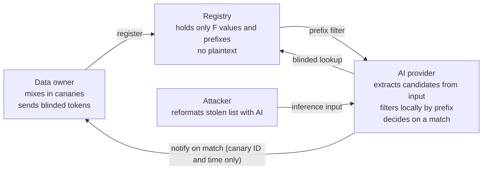

# Shinafure (品触れ): catching stolen customer lists at the entrance to AI

November 9, 2026 · Kobahiro

[日本語版（原文）はこちら](README.md). This English version is a translation of the Japanese article; both were published on the same day.

## Summary

Shinafure is a prototype that tells a data owner the moment its stolen customer data is fed into an AI model. I built it and tested it with a real LLM.

- **How it works.** A company mixes fake customers (canaries) into its own data and registers them in a shared registry. AI providers check inference inputs against the registry. The registry never holds plaintext, and prompt contents never reach the registry.
- **Results.** In outputs reformatted by a local LLM (qwen2.5:7b), every canary that survived was detected: 26 out of 26. There were zero false positives, both on 39 outputs without canaries and on 13.48 million characters of ordinary text.
- **Finding.** Canaries with rare names were deleted by the AI's preprocessing more often than the real customers around them (55% survived vs. 81%, p=0.007). Canaries with ordinary names showed no difference (75% vs. 78%). A model from another company (IBM's granite3.3:8b) showed the same pattern (43% vs. 69%, p=0.044). Canaries must blend into the name distribution of the data they protect.
- **Abuse prevention.** A registrant who slips a real person's email, or name and address, into its registration never gets notified. Canaries are generated from random tickets issued by the registry, and the registry checks them before any notification goes out (v0.4).
- **Speed.** Matching is about 14 times faster than in v0.4 (about 30 times for Japanese). One thread checks about 1.7 million Japanese characters per second, with detection results identical to v0.4 (v0.5).

## Background

Attackers have started using AI to sort and analyze the data they steal. Shinafure turns that workbench, the AI provider, into a place where leaks get noticed.

- On October 19, 2026, GMO Cybersecurity by Ierae reported that an attack infrastructure targeting about 20 Japanese companies was using an AI penetration-testing tool called ARTEX. Eight of those companies had disclosed data breaches in September and October ([ITmedia](https://www.itmedia.co.jp/news/article/2610/20/2000002423/), in Japanese).
- [CrowdStrike](https://www.crowdstrike.com/en-us/blog/unknown-threat-actor-uses-artex-to-target-south-korean-finance/) investigated attacks on South Korean financial institutions and found Claude Code session histories in the attacker's open directory (October 7, 2026). ARTEX's main LLM was DeepSeek.
- Existing decoy data is watched by the data owner, inside the owner's own monitoring perimeter. Once the data has been stolen and taken outside, the owner cannot see it.

In Japan, pawnshops check the goods brought to them against *shinafure* (品触れ), the notices of stolen goods circulated by the police. Shinafure applies the same idea to AI inference inputs.

## How it works

The registry holds no canary plaintext at all, and AI providers never send prompt contents to the registry. Even so, if a registered canary is in the input, it matches with certainty.



Only F values go into the registry, and only blinded candidates go from the provider to the registry.

1. **Make canaries.** Mix customers who do not exist into the data you protect. Emails use a domain you control plus a random suffix; phone numbers are numbers you own. 80% of the names are ordinary and 20% are rare (see "Finding" for why).
2. **Turn them into matching tokens.** Strong tokens are the email and the phone number. Weak tokens are the name (kanji, katakana, hiragana, and romanized in either order), the address, and the last 8 digits of the phone number. Full-width and half-width characters, +81 formats, and address variants such as "9丁目17番3号" and "9-17-3" are normalized to the same value.
3. **Register.** With a secret key k, the registry turns token t into F(t) = SHA256(x-coordinate of k·H(t)) (an OPRF on P-256). The registrant blinds t before asking for the computation, so the registry cannot tell what was registered. Only F values remain in the registry.
4. **The provider checks inputs.** The provider runs candidates extracted from the input through a 32-bit prefix filter, locally. Only candidates that pass are blinded and sent to the registry to compute F, which the provider compares with its own copy of the list of registered F values. Only on a match does it ask the registry for that canary's registration details. The number of computations is rate-limited per provider.
5. **Decide.** A canary is *confirmed*, and the registrant notified, when any of the following holds. Anything else is *suspect* and is not notified.
   - One strong token matches.
   - Two weak tokens of different kinds match, one of which is the address or the last 8 phone digits.
   - One input contains two or more different rare-name canaries.
6. **Notify.** A notification carries only the canary ID, the dataset name, the provider name, and the time. It never contains the prompt.

Looking things up with blinding and prefixes is the same idea as Google's Password Checkup (checking for leaked passwords). Shinafure applies it to canary person records.

## Experiment 1: synthetic data and text corpora

Every transformation that left personal values in the output was detected 10/10. There were zero false positives.

I mixed 10 canaries into 10,000 customers generated with Faker, applied transformations that imitate an attacker's processing, and then ran the check. False positives were measured by applying the same transformations to a customer list without canaries.

| Attacker-side transformation | Confirmed | False positives |
| --- | --- | --- |
| CSV, JSON, Markdown table | 10/10 | 0 |
| Column extraction (name + phone, name + address, email only) | 10/10 | 0 |
| Column extraction (name only) | 10/10 | 0 |
| English-ized (romanized names, +81 phone numbers) | 10/10 | 0 |
| Full-width digits, katakana, address variants | 10/10 | 0 |
| Phone numbers only (6 formats: parentheses, dots, spaces, etc.) | 10/10 | 0 |
| Grouping by family (with phone numbers) | 10/10 | 0 |
| Sent in 201 chunks of 50 rows | All 10 chunks containing a canary | 0/191 |
| Grouping by family (names only) | 0/10 | 0 |
| Summary (counts per prefecture only) | 0/10 | 0 |
| Canary domain spotted, rows deleted | 0/10 | 0 |

The name-only row is detected by the rule that two or more rare-name canaries in one input confirm. The last three rows are cases where no matchable value survives in the output, or where the attacker removed the canaries.

On text that contains no canaries, there were zero confirmed and zero suspect matches.

| Text | Characters | Confirmed | Suspect |
| --- | --- | --- | --- |
| JEITA corpus (Japanese literature and more) | 3.0M | 0 | 0 |
| KNBC corpus (Japanese blogs) | 0.13M | 0 | 0 |
| Project Gutenberg (English books) | 3.0M | 0 | 0 |
| Reuters (English news) | 3.0M | 0 | 0 |
| 50,000 customers generated with a different seed (CSV) | 4.35M | 0 | 0 |

That strong tokens (emails with random suffixes and the like) never match by chance is expected by design. What matters is that the rare-name combinations never appeared in any of the texts. The corpora come from [NLTK data](https://github.com/nltk/nltk_data).

## Experiment 2: reformatting by a real LLM

Even on outputs reformatted by a real LLM, detection succeeded in 25 of the 28 runs where it was possible (89%). There were zero false positives on the 32 outputs without canaries.

The scenario is a multi-stage one: the attacker reformats the list with an AI that does not participate, then passes the result to one that does. So I measured whether canaries survive in the first AI's **output**. If the first AI participates, the original list is caught the moment it is entered.

- Model: qwen2.5:7b (run locally with Ollama)
- Data: 8 blocks of 20 rows (4 with one canary each, 4 without)
- Instructions: 8 kinds, 64 calls in total (November 3, 2026)

| Instruction | With canary: detected | Without canary: false positives |
| --- | --- | --- |
| Convert to JSON | 4/4 | 0/4 |
| Extract names and phone numbers into a table | 4/4 | 0/4 |
| Extract names and addresses | 4/4 | 0/4 |
| Translate to English (romanized names, +81 phones) | 4/4 | 0/4 |
| Normalize phone number formats | 4/4 | 0/4 |
| Make a mailing list for an announcement | 4/4 | 0/4 |
| Group by family (same surname) | 1/4 | 0/4 |
| Summarize in 3 lines | 0/4 | 0/4 |

Summaries remove personal values, so missing them is expected. All three misses in family grouping were cases where the model deleted the canary's row entirely; neither the name nor the phone number was left in the output. The model also dropped leading zeros from phone numbers and mixed up surnames.

## Finding: canaries that stand out get deleted by AI

Rare-name canaries were deleted much more often than the real customers in the same outputs (55% survived vs. 81%, p=0.007). Ordinary-name canaries were deleted at the same rate as real customers. The same pattern reappeared with a model from another company.

The canaries deleted during family grouping in Experiment 2 all had rare names, such as 伊集院 (Ijuin) and 鷲見 (Sumi). So I ran only the "group by family" instruction with 20 ordinary-name canaries and 20 rare-name canaries (November 4–5, 2026, two random seeds). As a baseline, I also counted how many real customer rows survived in the same outputs.

| Canary type | Canaries surviving | Real customers surviving in the same outputs | Difference (Fisher's exact test, two-sided) |
| --- | --- | --- | --- |
| Rare names | 11/20 (55%) | 635/780 (81%) | p=0.007 |
| Ordinary names | 15/20 (75%) | 593/760 (78%) | p=0.78 |

To check that this is not a quirk of qwen, I ran the same experiment with IBM's granite3.3:8b (Apache 2.0) (November 11–13, 2026, 40 rows per call, the same seeds).

| Canary type | Canaries surviving | Real customers surviving in the same outputs | Difference (Fisher's exact test, two-sided) |
| --- | --- | --- | --- |
| Rare names | 6/14 (43%) | 374/540 (69%) | p=0.044 |
| Ordinary names | 13/18 (72%) | 502/696 (72%) | p=1.0 |

11 of the 80 calls timed out and are missing (more of them with rare names). For granite, real customers whose full name appears twice in a block are left out of the count. All 19 canaries that survived in outputs were detected, with zero false positives on 37 outputs without canaries.

- **The matcher never missed.** In the qwen experiment, all 26 canaries that survived in outputs were detected, with zero false positives on 39 outputs without canaries. Every miss came from the AI deleting the row.
- **Canaries must blend into the name distribution of the protected data.** Canaries that stand out get singled out and dropped by AI preprocessing.
- **Across a whole dataset, detection is close to certain.** Ordinary-name canaries disappear about 25% of the time. If rows disappear independently, the chance that all 10 of 10 canaries disappear is about one in a million.
- **So the prototype uses 80% ordinary names and 20% rare names.** Rare names are kept to catch extracts that contain only names. Ordinary names collide with real people, so they confirm only together with an address or phone number.

Two caveats. Rows in the same block are not independent, so the p-values are somewhat optimistic. And only two models and one kind of instruction were measured. Comparing ordinary and rare names directly, the difference was within chance for both models (qwen p=0.32, granite p=0.15).

## Preventing abuse: canaries no one can aim

A registrant who tries to target a real person never gets notified (v0.4). Canaries are generated from randomness the registry hands out, and the registry checks them before notifying anyone.

Shinafure notifies the registrant when a registered value appears in an AI input. Left as is, registering a real person's email, or name and address, would turn it into a tool for tracking that person. The registry cannot see what is registered (blind registration), so it cannot inspect registrations when they are made. Instead, it inspects them **before notifying**.

1. **Verify ownership.** The registrant proves control of email domains with a DNS TXT record, and of phone number blocks with a code sent to a random number inside the block.
2. **Generate canaries from tickets.** The registrant first commits to a secret value s and to the domain and number block it will use. Only then does the registry hand out a random value r, and the canary is derived from r and s by a fixed procedure. The registrant cannot choose the name, the address, or the numbers. Retries are limited by the number of tickets (100 per day by default).
3. **Deposit sealed openings.** For each token t, the opening (s and the rest) is encrypted under a key derived from k·H(t) and deposited with the registry. The registry holds only F(t), a hash of k·H(t), so it cannot open a deposit until a provider actually sees t and passes along the key.
4. **Check, then notify.** When a confirmed match is reported, the registry opens the deposit, regenerates the canary, and checks that every token registered under that ticket belongs to the canary and that the domain and number block are verified. It notifies only if all checks pass. A failed check changes nothing the registrant can observe, because asking questions or suspending the account would itself signal that the target's data appeared. The failure goes to a log for the operators.

These are the results when a stalker-like registrant, having passed ownership checks for its own domain and number block, tried each approach (`python -m demo.abuse`).

| Attempt | Provider's match | Notification to registrant |
| --- | --- | --- |
| Legitimate: the company's own canary email appears in an input | Match | Delivered |
| Slip a real person's email into a ticket | Match | Not delivered |
| Slip a real person's name and address into a ticket | Match | Not delivered |
| Make a canary with an unverified domain | Match | Not delivered |
| Make a canary with an unverified number block | Match | Not delivered |
| Add extra tokens to one ticket | – | Registration refused |

The provider still matches, but the registry's check stops the notification. Deriving a key from the data itself through a server's OPRF is the same construction as DupLESS, an encryption scheme for deduplicated storage.

v0.6 reduces chance coincidences further. Canary addresses are drawn from real towns with numbered 丁目 (about 91,000 town-chome units). Ordinary surnames are drawn according to how common they really are. To blend in with the protected data, addresses can be limited to one of the eight regions (地方), but not to a single prefecture: a prefecture with only 133 candidates, such as Shimane, would make it easier to aim at a particular person.

| | Up to v0.5 | v0.6 |
| --- | --- | --- |
| Address candidates | 43,200 (8 towns × 丁目, 番, 号) | about 54 million (about 91,000 real town-chome units × 番, 号) |
| Chance of hitting one specific person in a year (smallest region chosen) | at most about 0.2% | at most about 0.008% |
| Same (whole country) | – | at most about 0.0002% |

These figures assume drawing 100 tickets a day. With 1,000 canaries on real addresses registered, checking about 9.5 million characters of documents and customer lists produced zero confirmed matches.

## Matching speed

In v0.5, matching is about 14 times faster than in v0.4 (about 30 times for Japanese). Detection results are exactly the same as in v0.4.

With 1,000 canaries registered, v0.4 could check only about 50,000 Japanese characters per second. Most of the time went to two places: lookups for candidates that passed the prefix filter by chance, and hashing Japanese name candidates (about 4 per character) one at a time in Python.

1. **Curve arithmetic in OpenSSL.** F is now derived from the point's x-coordinate alone, so elliptic-curve multiplication can be handed to OpenSSL's ECDH. Each one drops from about 1.6 ms to about 0.07 ms. The pure-Python implementation remains, and both give the same values.
2. **Name candidates computed in bulk.** Name candidates now use a polynomial hash for their prefix, and all candidates in a text are computed at once with numpy.
3. **Prefix widened from 24 to 32 bits.** Candidates that pass the filter by chance drop to 1/256. A leaked filter can be abused at 24 bits just the same.

Measured with 1,000 canaries registered, in one thread (`python -m demo.bench corpus`). v0.4 figures are the faster of 2 runs; v0.5 figures are the fastest of 3.

| Text | Characters | v0.4 (chars/s) | v0.5 (chars/s) | Speedup | Registry lookups v0.4→v0.5 | Detection |
| --- | --- | --- | --- | --- | --- | --- |
| JEITA corpus (Japanese literature and more) | 1.0M | 55k | 1.75M | 32x | 1,648→18 | Same |
| KNBC corpus (Japanese blogs) | 0.13M | 61k | 1.64M | 27x | 236→16 | Same |
| Project Gutenberg (English books) | 1.0M | 1.35M | 2.71M | 2x | 46→15 | Same |
| Reuters (English news) | 1.0M | 1.48M | 2.74M | 2x | 44→16 | Same |
| Customer list CSV (Faker, Japanese) | 0.35M | 116k | 961k | 8x | 380→325 | Same |
| Total | 3.48M | 142k | 1.99M | 14x | | |

The number of candidates, the confirmed set and the suspect set all matched v0.4. English gains less because English text has few name candidates to begin with. The customer CSV needs more lookups because real customers' names coincide with ordinary-name canaries and become suspects.

This version also closes a privacy gap. In v0.4, even candidates that merely passed the prefix filter by chance had their F sent to the registry to check whether it was registered. The registry holds the key k, so by trying common names it could guess whose name an F belonged to. In v0.5, providers keep the list of registered F values and ask the registry only about matches. The list of F values alone cannot be compared with plaintext without the registry's OPRF.

## Plugging into an AI gateway

Shinafure can be added as a "guardrail" to LiteLLM (MIT), an AI gateway (v0.7). A few lines in its config file make every request get checked before it reaches the model.

```yaml
guardrails:
  - guardrail_name: shinafure
    litellm_params:
      guardrail: shinafure.integrations.litellm_guard.ShinafureGuardrail
      mode: pre_call
      default_on: true
```

There are two policies: flag and pass, or block. Tested on a real LiteLLM proxy (version 1.109), an ordinary customer list reached the model unchanged, a list containing a canary was refused with HTTP 403, and the registrant was notified. The prompt never leaves the gateway; only blinded candidates go to the registry.

## Limitations

Shinafure works only when data reaches a participating AI with personal values intact.

- **It does nothing against AI that does not participate.** It is powerless against attackers who run open models on their own machines or never put the data into an AI. On its own it is not decisive.
- **If personal values disappear, it cannot detect.** For example, when the data is summarized, rows are deleted, or surnames and given names end up on separate rows.
- **Canaries that are spotted get removed.** If canary emails all share one domain, an attacker who notices will delete those rows. You need several ordinary-looking domains and phone numbers you own. The same applies if the prefix filter leaks; it is meant to be given only to participating providers.
- **Abuse prevention still has a gap.** A canary from a legitimate ticket can, by chance, have the same name and address as a real person. Since v0.6 draws addresses from real town-chome units, drawing 100 tickets a day for a year gives at most about a 0.008% chance of hitting one specific person (about 0.0002% if addresses come from the whole country). The remaining bottleneck is the table of rare names (400 combinations). Number block verification is also a single SMS. And providers checking inputs at all needs to be squared with privacy law and, in Japan, the secrecy of communications.
- **What was measured is narrow.** Only two real LLMs (qwen2.5:7b and granite3.3:8b) were tested. Matching runs at about 1.7 million Japanese and 2.7 million English characters per second in one Python thread; behavior with millions of canaries has not been measured.

## Prior art and differences

In what I searched, I found nothing of the form "third-party data owners register person canaries, and AI providers check inference inputs against them and notify the owners." The closest work:

| Prior art | What it does | Difference from Shinafure |
| --- | --- | --- |
| [GitHub secret scanning partner program](https://docs.github.com/en/code-security/secret-scanning/secret-scanning-partnership-program/secret-scanning-partner-program) | Service providers register token formats; GitHub scans public repositories and notifies them | Closest in structure. Scans public code, and the registrants are token issuers |
| [Amazon US10977379](https://patents.google.com/patent/US10977379) (filed 2018) | Places decoy records in the company's own storage and monitors access | Only inside the owner's own monitoring perimeter |
| [CanaryTrace](https://aclanthology.org/2026.findings-emnlp.573/) (EMNLP 2026) | Data owners query a suspect RAG system to confirm unauthorized use | The owner investigates; not checked on the provider side |
| [HiddenLayer US12174954B1](https://patents.google.com/patent/US12174954B1/en) | An AI operator marks its own system prompt and monitors outputs | Protects the operator's own prompt from leaking |
| [Steganographic Canaries](https://arxiv.org/abs/2603.28655v1) (arXiv, March 2026) | Stops marked documents with a filter before they reach an LLM | Prevents use inside the organization's own environment |
| [JP Patent 7879396](https://www.j-platpat.inpit.go.jp/c1801/PU/JP-7879396/15/ja) (ヤツキ情報システム) | Replaces confidential strings with dummies before sending them to an external AI | Leak prevention on the sending side |
| [JP 2026-159423 A](https://www.j-platpat.inpit.go.jp/c1801/PU/JP-2026-159423/11/ja) (Nomura Research Institute) | Monitors a company LLM's inputs and outputs with signatures and judges false positives with another AI | Monitors attacks on the company's own system; canary tokens appear only as one technique |
| [DupLESS](https://www.usenix.org/conference/usenixsecurity13/technical-sessions/presentation/bellare) (USENIX Security 2013) | Derives encryption keys from the data itself through a server's OPRF, for deduplication | Shinafure uses the same construction to seal openings that even the registry cannot open until a match occurs |

For Japanese patents, I ran about 14 Boolean searches on [J-PlatPat](https://www.j-platpat.inpit.go.jp/p0100) on November 3, 2026. Twenty documents had both "decoy/canary" and "language model" in their claims, and most were unrelated. Combinations with "matching against registered data, notification, LLM" in the claims returned no relevant documents. I did not examine every claim, so I do not claim novelty outright.

## Reproduction and publication

The prototype is written in Python, and every experiment can be reproduced on an ordinary PC. No paid APIs were used.

- Code: this repository (Shinafure v0.7, 50 tests).
- Archive record: saved to [Software Heritage](https://archive.softwareheritage.org/swh:1:snp:674e293b03bd712c0c39f90451924e4484c97aa5) on November 9, 2026 (`swh:1:snp:674e293b03bd712c0c39f90451924e4484c97aa5`).
- Synthetic data and corpus experiments: `python -m demo.measure corpus` (about 1 minute)
- Real-LLM experiment: run qwen2.5:7b with [Ollama](https://ollama.com), then `python -m demo.llm_eval --backend ollama --chunks 4 --rows 20`. It took about 2 hours on a laptop without a GPU.
- Finding experiment: run with `--tasks family --canary-style ordinary` (or `rare`) with `--seed 11`, `--seed 12` and `--rows 40`, then aggregate with `python -m demo.pool --rows 40 "*.jsonl"`. For granite, add `--model granite3.3:8b`; it took about 18 hours on a laptop with a weak GPU.
- Abuse prevention check: `python -m demo.abuse` (a few seconds)
- Matching speed: `python -m demo.bench corpus` (about 1 minute)
- False positives with canaries on real addresses: `python -m demo.bench corpus --ticketed --no-plant --mb 3`
- Address data: derived from [Geolonia 住所データ](https://github.com/geolonia/japanese-addresses) (CC BY 4.0; built from MLIT location reference information and Japan Post postal code data) and bundled. Surname frequencies come from [Faker](https://github.com/joke2k/faker) (MIT).
- Data: all synthetic. No real personal information was used.

This article discloses the mechanisms described here as prior art (a defensive publication). The publication date is the day this article was published. It covers the following four points.

1. AI providers checking inference inputs against a registry of person canaries registered by third parties, and notifying the registrants
2. Performing that check with a registry that holds no plaintext (OPRF) and a prefix filter
3. Generating canary names to match the name distribution of the protected data (so that AI preprocessing does not single them out and delete them)
4. Preventing registrants from choosing a canary's contents (the registry hands out randomness after a commitment), sealing the opening under keys derived from each token's OPRF point, and having the registry open, regenerate and check it only when a provider reports a match, before notifying

## This repository

```bash
pip install -e ".[test]"
pytest -q                       # 50 tests
```

| Path | Contents |
| --- | --- |
| `shinafure/tokens.py` | Token normalization and candidate extraction from inputs |
| `shinafure/canary.py` | Canary generation for experiments |
| `shinafure/issuance.py` | Canaries no one can aim (tickets, sealed openings) |
| `shinafure/registry.py` | OPRF registry, ownership checks, pre-notification check, provider-side matching |
| `shinafure/fastscan.py` | Prefix filter and bulk computation of Japanese name candidates (numpy) |
| `shinafure/group.py` | OPRF curve arithmetic (OpenSSL and pure-Python implementations) |
| `shinafure/tables.py` | Address and name tables for ticketed canaries, and the coincidence bound |
| `shinafure/data/` | Address table (Geolonia, CC BY 4.0) and name table (Faker, MIT); sources in `NOTICE.md` |
| `scripts/build_tables.py` | Builds the address and name tables |
| `shinafure/integrations/litellm_guard.py` | LiteLLM guardrail (checks requests, then flags or blocks) |
| `shinafure/proxy.py` | OpenAI-compatible proxy (checks inputs, then flags or blocks) |
| `demo/measure.py` | Experiment 1 (synthetic data and text corpora) |
| `demo/llm_eval.py` | Experiment 2 and the finding experiment (real LLM) |
| `demo/pool.py` | Pools repeated runs and runs Fisher's exact test |
| `demo/abuse.py` | Abuse attempts and the results table |
| `demo/bench.py` | Matching speed measurement |
| `docs/DESIGN.md` | Design details, decision rules, changes per version (Japanese) |
| `results.md` | Experiment 1 results tables (Japanese) |

For the corpus experiments, put the [NLTK data](https://github.com/nltk/nltk_data) zips in `corpus/` (not included in this repository).
