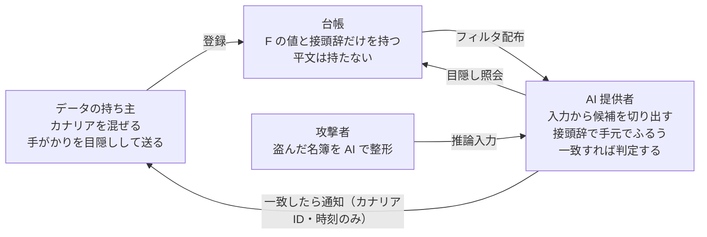

# 品触れ（Shinafure）：盗まれた名簿を AI の入口で見つける

2026年11月9日 · コバヒロ

## はじめに

盗まれた顧客データが AI に入力された瞬間に、データの持ち主へ知らせる仕組み「品触れ」を試作し、本物の LLM で検証しました。

- **仕組み**：企業が偽の顧客（カナリア）を自社のデータに混ぜて台帳に登録し、AI の提供者が推論への入力を台帳と照合します。台帳は平文を持たず、プロンプトの中身も台帳には出ません。
- **結果**：ローカル LLM（qwen2.5:7b）が整形した出力に残ったカナリアは、26人全員を検出しました。誤検知は、カナリアを含まない出力39回と、文書1,348万文字のどちらでも0件でした。
- **発見**：珍しい名前のカナリアは、AI の前処理で周りの本物の顧客より多く消されました（残った割合55%対81%、p=0.007）。普通の名前のカナリアには差がありません（75%対78%）。カナリアは、守るデータの名前の分布に溶け込ませる必要があります。
- **悪用防止**：登録者が実在の人のメールや氏名・住所を紛れ込ませても、通知は届きません。カナリアは台帳の乱数チケットから作られ、台帳は通知の前にそれを確かめます（v0.4）。

## 背景

攻撃者は、盗んだデータの整理や分析にも AI を使い始めています。その作業台（AI 提供者）を、漏えいを見つける場所にするのが品触れの考え方です。

- 2026年10月19日、GMO サイバーセキュリティ byイエラエは、日本企業約20社を狙った攻撃元で AI 侵入テストツール「ARTEX」の使用を確認したと発表しました。そのうち8社は、9〜10月に情報漏えいを公表していました（[ITmedia](https://www.itmedia.co.jp/news/article/2610/20/2000002423/)）。
- [CrowdStrike](https://www.crowdstrike.com/en-us/blog/unknown-threat-actor-uses-artex-to-target-south-korean-finance/) は、韓国の金融機関への攻撃を調べ、攻撃者の公開ディレクトリから Claude Code のセッション履歴を見つけました（2026年10月7日）。ARTEX の主な LLM は DeepSeek でした。
- 既存のおとりデータは、データの持ち主が自分の監視範囲の中で見張るものです。盗まれて外に出た後は、持ち主からは見えません。

古物商は、警察から回ってくる「品触れ」（盗品の手配書）と持ち込まれた品物を照らし合わせます。品触れは、これを AI の推論入力に当てはめます。

## 仕組み

台帳はカナリアの平文を一切持たず、AI 提供者はプロンプトの中身を台帳に送りません。それでも、登録されたカナリアが入力に含まれていれば確実に一致します。



台帳に入るのは F の値だけで、提供者から台帳に出るのは目隠しした候補だけです。

1. **カナリアを作る**：守るデータに、実在しない顧客を混ぜます。メールは自社が管理するドメインに乱数を付けたもの、電話番号は自社が保有する番号を使います。氏名は8割を普通の名前、2割を珍しい名前にします（理由は「発見」の節）。
2. **照合用の手がかりにする**：強い手がかりはメールと電話番号です。弱い手がかりは、氏名（漢字・カタカナ・ひらがな・順不同のローマ字）、住所、電話番号の下8桁です。全角・半角、+81 形式、「9丁目17番3号」と「9-17-3」などの表記ゆれは、同じ値に正規化します。
3. **台帳に登録する**：台帳が秘密に持つ鍵 k で、手がかり t を F(t) = SHA256(k·H(t)) に変えます（OPRF、P-256 上の計算）。登録者は t を目隠ししてから計算を頼むので、台帳は何を登録されたか分かりません。台帳に残るのは F の値だけです。
4. **提供者が照合する**：提供者は、入力から切り出した候補を24ビットの接頭辞フィルタで手元でふるいにかけます。通過した候補だけを目隠しして台帳に問い合わせます。問い合わせの回数は、提供者ごとに制限します。
5. **判定する**：次のどれかを満たすと「確定」とし、登録者に通知します。それ以外は「疑い」とし、通知しません。
   - 強い手がかりが1つ一致する
   - 種類の違う弱い手がかりが2つ一致し、その片方が住所か電話番号の下8桁
   - 1つの入力に、珍しい名前のカナリアが2人分以上ある
6. **通知する**：通知に含めるのは、カナリアID、データセット名、提供者名、時刻だけです。プロンプトは含めません。

目隠しと接頭辞で問い合わせる方式は、Google の Password Checkup（漏えいしたパスワードの照会）と同じ考え方です。品触れは、それをカナリアの人物データに使います。

## 実験1：合成データと文書コーパス

個人の値が出力に残る変換であれば、すべて 10/10 で検出しました。誤検知は0件です。

顧客10,000人（Faker で生成）にカナリア10人を混ぜ、攻撃者の処理を模した変換をかけてから照合しました。誤検知は、同じ変換をカナリアなしの名簿にかけて測っています。

| 攻撃者側の変換 | 確定で検出 | 誤検知 |
| --- | --- | --- |
| CSV、JSON、Markdown 表 | 10/10 | 0 |
| 列の抽出（氏名＋電話、氏名＋住所、メールのみ） | 10/10 | 0 |
| 列の抽出（氏名のみ） | 10/10 | 0 |
| 英語化（ローマ字氏名・+81 の電話） | 10/10 | 0 |
| 全角数字・カタカナ・住所の表記ゆれ | 10/10 | 0 |
| 電話番号のみ（括弧・ドット・空白など6種の書式） | 10/10 | 0 |
| 家族ごとの名寄せ（電話あり） | 10/10 | 0 |
| 50行ずつ201回に分けて送信 | カナリアを含む10回すべて | 0/191 |
| 家族ごとの名寄せ（名前のみ） | 0/10 | 0 |
| 要約（都道府県別の件数のみ） | 0/10 | 0 |
| カナリア用のドメインに気づかれ、行ごと削除 | 0/10 | 0 |

氏名のみの行は、珍しい名前のカナリアが2人分以上そろうルールで検出しています。最後の3行は、照合できる値が出力に残らない、もしくは攻撃者に取り除かれたケースです。

カナリアを含まない文書では、確定も疑いも0件でした。

| 文書 | 文字数 | 確定 | 疑い |
| --- | --- | --- | --- |
| JEITA コーパス（日本語の文学作品など） | 300万 | 0 | 0 |
| KNBC コーパス（日本語のブログ） | 13万 | 0 | 0 |
| Project Gutenberg（英語の書籍） | 300万 | 0 | 0 |
| Reuters（英語のニュース） | 300万 | 0 | 0 |
| 別の乱数で作った顧客5万人（CSV） | 435万 | 0 | 0 |

強い手がかり（乱数付きのメールなど）が偶然一致しないのは、設計上当然です。意味があるのは、珍しい名前の組み合わせが、どの文書にも現れなかったことです。コーパスは [NLTK data](https://github.com/nltk/nltk_data) から取得しました。

## 実験2：本物の LLM に整形させる

本物の LLM が整形した出力でも、検出できるはずの28回のうち25回（89%）で検出しました。カナリアなしの出力32回での誤検知は0件です。

想定したのは、攻撃者が参加していない手元の AI で名簿を整形し、その結果を参加している AI に渡す多段の場合です。そこで、1段目の AI の**出力**にカナリアが残るかを測りました。1段目の AI が参加していれば、元の名簿が入力された時点で検出できます。

- モデル：qwen2.5:7b（Ollama でローカル実行）
- データ：20行のブロック8個（カナリア1人入り4個、カナリアなし4個）
- 指示：8種類、計64回の呼び出し（2026年11月3日）

| 指示 | カナリア入り：検出 | カナリアなし：誤検知 |
| --- | --- | --- |
| JSON に変換 | 4/4 | 0/4 |
| 氏名と電話番号を抽出して表にする | 4/4 | 0/4 |
| 氏名と住所を抽出 | 4/4 | 0/4 |
| 英訳（ローマ字氏名、+81 の電話） | 4/4 | 0/4 |
| 電話番号の書式を統一 | 4/4 | 0/4 |
| 案内メールの宛名リストを作る | 4/4 | 0/4 |
| 同じ名字で家族ごとにまとめる | 1/4 | 0/4 |
| 3行で要約 | 0/4 | 0/4 |

要約では個人の値が消えるので、検出できないのは想定どおりです。名寄せの見逃し3件は、すべてモデルがカナリアの行を丸ごと消したものでした。氏名も電話番号も、出力に残っていません。モデルはほかにも、電話番号の先頭の0を落としたり、名字を取り違えたりしていました。

## 発見：目立つカナリアは AI に消される

珍しい名前のカナリアは、同じ出力の中の本物の顧客より明らかに多く消されました（残った割合55%対81%、p=0.007）。普通の名前のカナリアは、本物の顧客と同じ割合でしか消されていません。

実験2で名寄せに消されたカナリアは、伊集院・鷲見といった珍しい名前ばかりでした。そこで、「同じ名字で家族ごとにまとめる」指示だけを、普通の名前と珍しい名前のカナリアで20人ずつ試しました（2026年11月4〜5日、乱数の種を2つ使用）。同じ出力の中の本物の顧客の行がどれだけ残ったかも数え、基準にしています。

| カナリアの種類 | カナリアが残った | 同じ出力の本物の顧客が残った | 差（Fisher の正確確率検定、両側） |
| --- | --- | --- | --- |
| 珍しい名前 | 11/20（55%） | 635/780（81%） | p=0.007 |
| 普通の名前 | 15/20（75%） | 593/760（78%） | p=0.78 |

- **照合は一度も見逃していません。** 出力に残ったカナリアは26人全員を検出し、カナリアなしの出力39回での誤検知は0件でした。見逃しはすべて、AI が行を消したことによるものです。
- **カナリアは、守るデータの名前の分布に溶け込ませる必要があります。** 目立つカナリアは、AI による前処理で選んで落とされます。
- **データ全体では、ほぼ確実に見つかります。** 普通の名前のカナリアが消える割合は約25%です。行が独立に消えると仮定すれば、10人入れておけば全員が消える確率は約100万分の1です。
- **そのため、試作では普通の名前を8割、珍しい名前を2割にしました。** 珍しい名前を残しているのは、氏名だけを抜き出された場合に検出するためです。普通の名前は実在の人と重なるので、住所か電話番号と組み合わせたときだけ確定にしています。

この検定には注意点が2つあります。同じブロックの行どうしは独立ではないので、p 値はやや楽観的です。また、測ったのは1つのモデル、1種類の指示だけです。普通の名前と珍しい名前を直接比べると、差は偶然の範囲でした（p=0.32）。

## 悪用を防ぐ：狙い撃ちできないカナリア

登録者が実在の人を狙って登録しても、通知は届かないようにしました（v0.4）。カナリアは台帳が渡す乱数から作られ、台帳は通知の前にそれを確かめます。

品触れは、登録した値が AI の入力に出たら登録者に知らせます。そのままでは、実在の人のメールや氏名・住所を登録すれば、その人を追跡する道具になります。台帳は登録の中身を見られない（目隠し登録）ので、登録の時点では検査できません。そこで、**通知の前に**検査します。

1. **所有を確認する**：登録者は、メールのドメインを DNS の TXT レコードで、電話番号のブロックを「ブロック内のランダムな番号に送ったコード」で確認します。
2. **カナリアをチケットから作る**：登録者はまず、秘密の値 s と、使うドメイン・番号ブロックにコミットします。その後で台帳が乱数 r を渡し、カナリアは r と s から決まった手順で作られます。登録者は氏名も住所も番号も選べません。やり直せるのはチケットの枚数（既定で1日100枚）までです。
3. **開示を封印して預ける**：手がかり t ごとに、s などの開示値を k·H(t) から作った鍵で暗号化して預けます。台帳が持つのは F(t)（k·H(t) のハッシュ）だけなので、提供者が実際に t を見て鍵を渡すまで、台帳にも開けません。
4. **確かめてから通知する**：確定の報告が来たら、台帳は開示を開け、カナリアを作り直し、そのチケットに登録された手がかりがすべてそのカナリアのものか、ドメインと番号ブロックが確認済みかを調べます。通ったときだけ通知します。失敗しても、登録者から見える変化はありません。問い合わせや利用停止は、それ自体が「標的のデータが出た」という合図になるからです。記録は運営者向けのログに残します。

ストーカー役の登録者が、自分のドメインと番号ブロックの確認を通ったうえで試した結果です（`python -m demo.abuse`）。

| 試み | 提供者の照合 | 登録者への通知 |
| --- | --- | --- |
| 正規：自社カナリアのメールが入力に出る | 一致 | 届いた |
| 実在の人のメールをチケットに紛れ込ませる | 一致 | 届かない |
| 実在の人の氏名と住所を紛れ込ませる | 一致 | 届かない |
| 所有を確認していないドメインでカナリアを作る | 一致 | 届かない |
| 所有を確認していない番号ブロックでカナリアを作る | 一致 | 届かない |
| 1枚のチケットに手がかりを足す | － | 登録を拒否 |

提供者の照合では一致しても、台帳の確認で止まります。データそのものからサーバの OPRF で鍵を作る部分は、重複排除のための暗号化方式 DupLESS と同じ構成です。

## 限界

品触れが効くのは、参加している AI に、個人の値が残った形でデータが入ったときだけです。

- **参加しない AI には効きません。** オープンなモデルを手元で動かす攻撃者や、データを AI に入れない攻撃者には無力です。単独では決定打になりません。
- **個人の値が消えると検出できません。** 要約された、行ごと消された、名字と名前が別の行に分かれた、といった場合です。
- **見破られると取り除かれます。** カナリアのメールを1つのドメインにまとめると、気づいた攻撃者に行ごと消されます。普通に見える複数のドメインと、自社が保有する電話番号が必要です。接頭辞フィルタが漏れた場合も同じで、参加する提供者にだけ渡す前提です。
- **悪用防止には穴が残ります。** 正規のチケットから作ったカナリアでも、たまたま実在の人と同じ氏名と住所になることはありえます。試作の表は小さく（氏名は珍しい名前だけに絞ると400通り、住所は4万3,200通り）、1日100枚を1年引き続けると、特定の1人に当たる確率は最大約0.2%です。番号ブロックの確認も SMS 1回だけです。提供者が入力を照合すること自体にも、プライバシーや通信の秘密との整理が要ります。
- **測った範囲が狭いです。** 本物の LLM は1つのモデル（qwen2.5:7b）だけです。照合は純 Python で、日本語は約20万文字/秒と遅いです。

## 先行例と差分

「第三者のデータ所有者が人物カナリアを登録し、AI 提供者が推論入力を照合して通知する」形は、調べた範囲では見つかりませんでした。近いものは次のとおりです。

| 先行例 | 何をするか | 品触れとの差 |
| --- | --- | --- |
| [GitHub secret scanning パートナープログラム](https://docs.github.com/en/code-security/secret-scanning/secret-scanning-partnership-program/secret-scanning-partner-program) | サービス提供者がトークンの形式を登録し、GitHub が公開リポジトリを走査して通知する | 構造が最も近い。走査対象が公開コードで、登録するのはトークンの発行元 |
| [Amazon US10977379](https://patents.google.com/patent/US10977379)（2018年出願） | 自社のストレージにおとりの記録を置き、アクセスを監視する | 持ち主自身の監視範囲の中だけ |
| [CanaryTrace](https://aclanthology.org/2026.findings-emnlp.573/)（EMNLP 2026） | データの持ち主が、疑わしい RAG システムに問い合わせて不正利用を確かめる | 持ち主が自分で調べる方式。提供者側の照合ではない |
| [HiddenLayer US12174954B1](https://patents.google.com/patent/US12174954B1/en) | AI の運営者が、自分のシステムプロンプトに印を入れ、出力を監視する | 運営者自身の漏えい対策 |
| [Steganographic Canaries](https://arxiv.org/abs/2603.28655v1)（arXiv、2026年3月） | 印を埋めた文書を、LLM に入る前のフィルタで止める | 自組織の環境での利用防止 |
| [特許7879396](https://www.j-platpat.inpit.go.jp/c1801/PU/JP-7879396/15/ja)（ヤツキ情報システム） | 外部の AI に送る前に、機密の文字列をダミーに置き換える | 送る側の情報漏えい対策 |
| [特開2026-159423](https://www.j-platpat.inpit.go.jp/c1801/PU/JP-2026-159423/11/ja)（野村総合研究所） | 自社 LLM の入出力をシグネチャで監視し、別の AI で誤検知を判定する | 自社システムへの攻撃の監視。カナリアトークンは手法の1つとして登場するだけ |
| [DupLESS](https://www.usenix.org/conference/usenixsecurity13/technical-sessions/presentation/bellare)（USENIX Security 2013） | 重複排除のため、サーバの OPRF を通してデータそのものから暗号鍵を作る | 品触れは同じ構成を、照合が起きるまで台帳にも開けない「開示」の封印に使う |

日本の特許は、2026年11月3日に [J-PlatPat](https://www.j-platpat.inpit.go.jp/p0100) の論理式で約14回検索しました。「おとり・カナリア」と「言語モデル」を両方請求項に含む文献は20件ありましたが、大半は無関係でした。「登録データとの照合・通知・ LLM」を請求項に含む組み合わせでは、関係する文献は0件でした。請求項をすべて精査したわけではないので、新規だと断定はしません。

## 再現方法と公開について

試作は Python で書き、すべての実験を手元の PC で再現できます。有料の API は使っていません。

- コード：このリポジトリ（品触れ v0.4、テスト32本）。
- 合成データとコーパスの実験：`python -m demo.measure corpus`（約1分）
- 本物の LLM の実験：[Ollama](https://ollama.com) で qwen2.5:7b を動かし、`python -m demo.llm_eval --backend ollama --chunks 4 --rows 20` を実行します。GPU の無いノート PC で約2時間かかりました。
- 発見の実験：`--tasks family --canary-style ordinary`（または `rare`）に `--seed 11` と `--seed 12` を付けて実行し、`python -m demo.pool` で集計します。
- 悪用防止の確認：`python -m demo.abuse`（数秒）
- データ：すべて合成です。実在の個人情報は使っていません。

この記事は、ここに記した仕組みを先行技術として公開するものです（防衛的公開）。公開日は、この記事を公開した日です。対象は次の4点です。

1. AI 提供者が推論入力を、第三者が登録した人物カナリアの台帳と照合し、登録者に通知すること
2. その照合を、平文を持たない台帳（OPRF）と接頭辞フィルタで行うこと
3. カナリアの氏名を、守るデータの名前の分布に合わせて作ること（AI による前処理で選んで消されないため）
4. 登録者がカナリアの中身を選べないようにし（コミットの後に台帳が乱数を渡す）、開示を手がかりごとの OPRF 点から作った鍵で封印して、提供者が照合したときにだけ台帳が開封・再生成・確認してから通知すること

## このリポジトリ

```bash
pip install -e ".[test]"
pytest -q                       # 32本
```

| 場所 | 中身 |
| --- | --- |
| `shinafure/tokens.py` | 手がかりの正規化と、入力からの候補の切り出し |
| `shinafure/canary.py` | 実験用のカナリア生成 |
| `shinafure/issuance.py` | 狙い撃ちできないカナリア（チケット、封印した開示） |
| `shinafure/registry.py` | OPRF 台帳、所有確認、通知前の検査、提供者側の照合 |
| `shinafure/proxy.py` | OpenAI 互換のプロキシ（照合して印を付ける／止める） |
| `demo/measure.py` | 実験1（合成データと文書コーパス） |
| `demo/llm_eval.py` | 実験2と発見の実験（本物の LLM） |
| `demo/pool.py` | 複数回の実験の集計と Fisher 検定 |
| `demo/abuse.py` | 悪用の試みと結果の表 |
| `docs/DESIGN.md` | 設計の詳細、判定ルール、改版ごとの変更点 |
| `results.md` | 実験1の結果表 |

コーパスの実験には、[NLTK data](https://github.com/nltk/nltk_data) の zip を `corpus/` に置きます（リポジトリには含めていません）。
